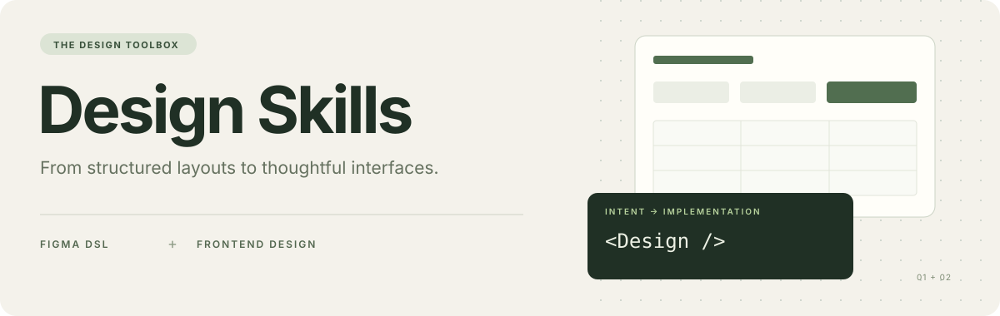

<p align="center">
  
</p>

<h1 align="center">Design Skills · 设计助手工具箱</h1>

<p align="center">把设计意图写清楚，把界面细节做扎实。</p>

<p align="center">
  <a href="#快速开始">快速开始</a> ·
  <a href="figma-design-assistant/README.md">Figma 设计助手</a> ·
  <a href="frontend-design/README.md">前端设计 Skill</a> ·
  <a href="#如何配合使用">配合使用</a>
</p>

---

这里汇集两份设计辅助工具：一份把结构化 JSON 组合成 Figma 中的组件布局，一份指导 AI 编程助手把视觉方向落到前端代码。原始附件、可编辑源码、安装说明和任务示例统一保存在这个仓库。

## 工具一览

| 模块 | 解决什么问题 | 入口与依赖 |
| --- | --- | --- |
| **[Figma 设计助手](figma-design-assistant/README.md)** | 用 DSL 描述页面标题、筛选栏和表格，在 Figma 中组合已有组件 | Figma 开发插件；需要当前文件中的对应组件及字体 |
| **[Frontend Design Skill](frontend-design/README.md)** | 为组件、页面和应用确定视觉方向，并指导 AI 助手完成前端实现 | 标准 `SKILL.md`；需要支持 Skill 的编码助手和实际前端项目 |

Figma 模块当前提供的是 **DSL 导入插件、映射模板与说明**；前端模块提供的是 **可安装的 Skill**。两部分可以分别使用，也可以配合同一项设计任务使用。

## 快速开始

### 1. 获取仓库

```bash
git clone https://github.com/Ye-Zayne/design-skills.git
cd design-skills
```

私有仓库需要相应访问权限及 GitHub 身份验证。也可以在 GitHub 的 **Code → Download ZIP** 下载整个仓库后解压。

### 2. 选择入口

**需要 Figma 设计稿**

1. 阅读 [Figma 快速开始](figma-design-assistant/README.md#快速开始)，准备组件所在的 Figma 文件。
2. 按模块说明创建本地开发插件，取得 Figma 分配的插件 ID，再配置 `figma-design-assistant/figma-plugin/manifest.json`。
3. 从 [示例目录](figma-design-assistant/examples/) 选择 DSL，按说明替换当前文件的组件 ID，再粘贴到插件中导入。

**需要前端页面或组件**

1. 将整个 `frontend-design/` 目录安装到编码助手的 Skill 目录。
2. Codex 的用户级位置为 `~/.agents/skills/frontend-design/`，项目级位置为 `<项目根目录>/.agents/skills/frontend-design/`。已有同名目录时先检查内容。
3. 在实际前端项目中调用 `$frontend-design`，提供页面目标、技术栈和设计约束。

完整步骤见 [前端 Skill 安装说明](frontend-design/README.md#快速开始)；安装目录依据 [Codex 官方文档](https://learn.chatgpt.com/docs/build-skills)。

### 3. 描述你的任务

```text
使用 frontend-design 完成一个内容管理后台。

用途：运营人员查询内容、查看状态并执行批量操作。
技术：沿用当前项目的框架和组件库。
页面：标题、筛选区域、表格、分页及空状态。
风格：清晰克制，突出数据层级和主要操作。
约束：支持手机与桌面，保留键盘焦点，减少不必要的动效。

先说明设计方向，再实现页面，最后说明验证结果。
```

更多场景见 [前端任务示例](frontend-design/examples/briefs.md)。Figma 的组件依赖与 DSL 细节见 [模块说明](figma-design-assistant/README.md)。

## 如何配合使用

```text
需求与约束
    │
    ├─ Figma 设计助手 → DSL JSON → 组件布局与设计稿
    │
    └─ Frontend Design Skill → 视觉方向 → 前端代码与交互
```

例如，制作后台页面时，可以先用 Figma 模块搭建标题、筛选和表格布局，再把已确认的设计稿、尺寸、组件规范与交互要求交给前端 Skill。两部分之间的设计信息需要显式提供；仓库目前不包含自动同步或设计稿转代码服务。

## 目录

```text
design-skills/
├── README.md                       # 统一首页与使用入口
├── CHANGELOG.md                    # 整理与修复记录
├── assets/                         # 首页视觉素材
├── figma-design-assistant/
│   ├── README.md                   # 插件安装、依赖与使用说明
│   ├── figma-plugin/               # 当前插件源码与 manifest
│   ├── figma-dsl-schema.json        # 原始 DSL 示例和组件映射模板
│   ├── examples/                   # DSL 示例
│   ├── docs/                       # DSL 参考与组件准备说明
│   ├── tests/                      # 小范围行为回归测试
│   └── figma-plugin10.zip          # 原始插件附件
└── frontend-design/
    ├── SKILL.md                    # 前端设计 Skill 入口
    ├── README.md                   # 安装、调用与场景说明
    ├── agents/openai.yaml          # Codex 展示信息与默认提示
    ├── examples/briefs.md           # 可修改的任务描述
    ├── _meta.json                  # 原始元数据
    └── frontend-design-skill.zip    # 原始 Skill 附件
```

## 版本与原始附件

日常使用以目录中的**当前源码与文档**为准。两个 ZIP 原样保留，便于追溯最初附件，其中不包含后续修复和新增说明。`_meta.json` 的版本号属于原始前端 Skill 包，不代表整个工具箱的版本。

Figma 组件 ID 来自原始设计文件，复制到其他文件后需要重新映射。`figma-dsl-schema.json` 是示例与约定模板，不是标准 JSON Schema 校验文件。具体限制和排查方法见各模块说明。

## 反馈与维护

遇到问题可以在本仓库的 [Issues](https://github.com/Ye-Zayne/design-skills/issues) 提供使用模块、复现步骤、预期与实际结果，以及可分享的最小示例。Figma 问题可附组件类型和文字图层名称；前端 Skill 问题可附助手类型、技术栈和任务描述。

原始附件未包含许可证，本次整理未补充许可声明。
