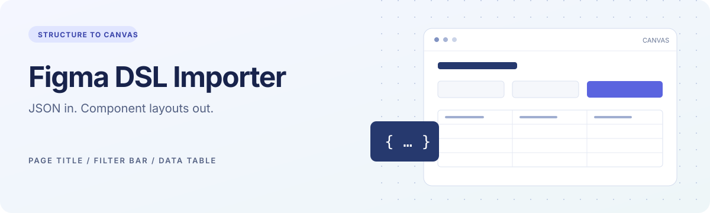

<div align="center">

# Figma 设计助手



[返回 Design Skills 首页](../README.md)

**把结构化页面描述，转成基于现有组件的可编辑 Figma 页面。**

DSL JSON · 组件实例 · 自动布局 · 中文使用说明

[快速开始](#快速开始) · [示例](examples/) · [DSL 字段说明](docs/dsl-reference.md) · [问题排查](docs/troubleshooting.md)

</div>

## 它能做什么

适合已有组件库的后台管理页面：用 JSON 组合页面标题、筛选区和数据表格，插件在**当前 Figma 文件**中查找组件并创建实例，再填入文案和数据。

| 模块 | 当前能力 |
| --- | --- |
| 页面标题 `PageTitle` | 创建组件实例，按文本图层名称替换文案 |
| 筛选区 `FilterBar` | 每行三个槽位，末行放置操作区并自动补占位组件 |
| 表格区 `TableSection` | 标题、工具栏、表头、数据行和分页组件 |
| 页面容器 | 配置名称、宽度、间距、内边距和圆角，生成纵向自动布局 Frame |

当前交付物是 **DSL 模板和 Figma 开发插件**，并不包含可直接安装到 AI 助手的标准 `SKILL.md`。AI 可以参照模板生成 JSON，生成结果仍需使用你自己的组件 ID 和文本图层名称。

## 快速开始

### 1. 下载并导入插件

1. 下载整个仓库 ZIP 并解压，进入本模块目录 `figma-design-assistant/`。
2. 在 Figma 桌面端的开发插件菜单使用「创建新插件 / Create new plugin」，让 Figma 为你生成插件和它自己的 `id`。
3. 从 Figma 生成的 manifest 中复制 `id`，替换本模块 [`figma-plugin/manifest.json`](figma-plugin/manifest.json) 中的 `"id": "figma-dsl-importer"`。原值只是占位示例，不是可发布的真实插件 ID。保留 `documentAccess`、`networkAccess` 以及其余入口配置。
4. 打开用于生成页面的设计文件，从开发插件菜单选择导入 manifest，选择本模块 `figma-plugin/manifest.json`。菜单名称可能随 Figma 版本和语言不同而变化。
5. 从开发插件列表运行 **Figma DSL Importer**。

插件直接运行 JavaScript，无需安装 npm 依赖或构建。当前源码启用 `documentAccess: "dynamic-page"`，通过 `getNodeByIdAsync` 异步查找组件；`networkAccess.allowedDomains` 为 `["none"]`，不请求外部网络。

插件 ID 应由 Figma 分配，配置与动态加载 API 依据 [Figma Manifest 官方说明](https://developers.figma.com/docs/plugins/manifest/) 和 [动态加载迁移指南](https://developers.figma.com/docs/plugins/migrating-to-dynamic-loading/)。

### 2. 先验证基础导入

复制 [`examples/minimal.dsl.json`](examples/minimal.dsl.json) 的完整内容到插件，点击「导入到 Figma」。这个示例不引用组件，会创建一个空白页面容器，用于验证插件可以运行；它不是完整的业务页面。

### 3. 接入你自己的组件

1. 打开 [`examples/admin-list.dsl.json`](examples/admin-list.dsl.json)。
2. 将全部 `componentId` 和 `componentIds` 替换为当前文件中实际的组件或组件集节点 ID；替换筛选区的 `placeholderComponentId`。
3. 对照 [字段说明](docs/dsl-reference.md) 检查文本图层名称、表格列数和行组件变体。
4. 粘贴 JSON 并导入。成功后会定位到生成的 Frame；它位于当前页面的 `(100, 100)` 附近。

**示例中的 ID 来自原始文件，不是通用组件库地址。** 在其他文件中直接导入业务示例，通常会提示找不到组件。该插件不会自动下载、搜索或导入远程组件库。

## 一份 DSL 的结构

```json
{
  "schema": "figma-dsl",
  "version": "1.0",
  "page": {
    "name": "订单管理",
    "width": 1208,
    "padding": 24,
    "gap": 24,
    "cornerRadius": 16,
    "fontFamily": "PingFang SC"
  },
  "sections": []
}
```

[`figma-dsl-schema.json`](figma-dsl-schema.json) 是原始的**示例模板和组件映射表**，不是标准 JSON Schema，不能直接当作校验器使用。`$defs` 中的映射和尺寸规则主要用于生成 DSL 时参考，插件不会自动读取或应用这些映射。

## 仓库内容

```text
figma-plugin/                 当前插件源码
  manifest.json               开发插件入口
  code.js                     组件实例化与布局
  ui.html                     JSON 输入和导入状态
assets/banner.svg              模块首页横幅
examples/
  minimal.dsl.json             不依赖组件的基础验证示例
  admin-list.dsl.json          需要替换组件 ID 的管理列表示例
docs/
  dsl-reference.md             字段、文本匹配和布局约定
  troubleshooting.md          安装与导入问题排查
tests/importer.test.cjs        本地回归检查
figma-dsl-schema.json          保留的原始模板与组件映射
figma-plugin10.zip             保留的原始插件快照
```

**使用和修改请以 `figma-plugin/` 源码为准。** `figma-plugin10.zip` 原样保留，未包含仓库后续修复。

## 使用边界

- 生成的是设计稿和组件实例；按钮、筛选和分页不会连接业务数据，也不会自动成为可运行的产品功能。
- `page.fontFamily` 用于预加载字体，并不会统一替换组件文本的实际字体。组件包含其他字体或混合字重时，写入文本仍可能失败，见 [字体排查](docs/troubleshooting.md#字体加载或文本修改失败)。
- 表格单元格按组件内名为 `text` 的文本节点遍历顺序写入。组件结构不匹配时，需先调整组件或映射。
- 表格列变体、按钮变体由传入的组件 ID 决定；`variant`、`columns[].type` 和 `$defs` 中的宽度不会自动切换变体或调整列宽。
- 未知 `section.type` 会被跳过；导入中途失败时，画布上可能留有部分生成内容。再次导入会创建新 Frame，不会覆盖旧稿。

## 本地检查

需要已安装 Node.js，在本模块目录 `figma-design-assistant/` 中运行：

```bash
node --test tests/importer.test.cjs
node --check figma-plugin/code.js
```

回归检查使用 Figma API 的轻量替身，覆盖动态加载的异步组件查找、输入错误、占位映射、表格零值写入和导入按钮状态。真实字体、组件布局和 Figma 桌面端渲染仍需在目标文件内检查。

发现问题时，请在仓库的 Issues 页面提供报错、脱敏后的 DSL 和相关组件结构。原始附件未包含许可证，本次整理未补充许可声明。
