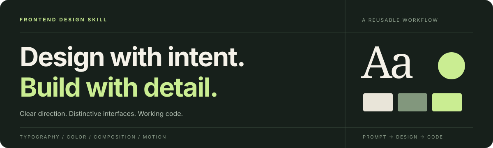

# Frontend Design Skill



[返回 Design Skills 首页](../README.md)

让 AI 编码助手在编写前端时，先明确设计方向，再把排版、配色、布局和动效落到可运行的代码中。

**界面设计 · 前端实现 · 视觉细节**

[快速开始](#快速开始) · [使用示例](#使用示例) · [设计原则](#设计原则) · [文件说明](#文件说明)

## 这是什么

这是一个以 `SKILL.md` 为入口的前端设计技能包。它为支持 Skill 的 AI 编码助手提供设计与实现指导，用于组件、页面和应用界面的创建或改版。

仓库提供的是**设计工作方法和提示指令**，没有独立运行的前端应用，也不需要在本仓库执行 `npm install`。框架、组件库和构建环境由实际项目决定。

## 适合用来做什么

| 场景 | 使用重点 |
| --- | --- |
| 产品落地页 | 明确品牌气质，组织首屏信息、行动入口和视觉节奏 |
| 个人作品集 | 建立个人风格，让项目叙事与页面布局相互配合 |
| 数据看板、业务后台 | 在表格、筛选和状态反馈中保持层级清晰 |
| 组件与页面改版 | 沿用项目约束，改善字体、间距、配色和交互细节 |

## 快速开始

### 1. 获取文件

这是 [Design Skills](https://github.com/Ye-Zayne/design-skills) 仓库中的 `frontend-design/` 模块。先把整仓下载到一个临时目录：

```bash
frontend_skill_source="$(mktemp -d)"
git clone https://github.com/Ye-Zayne/design-skills.git "$frontend_skill_source/design-skills"
```

仓库为私有时，需要先取得访问权限并完成 GitHub 身份验证。也可以下载仓库 ZIP 并找到其中的 `frontend-design/` 目录。

模块中的 `frontend-design-skill.zip` 是保留的原始附件；使用本仓库整理后的版本时，请使用 `frontend-design/` 目录中的当前文件。

### 2. 安装或加载 Skill

安装时复制 **`frontend-design/` 子目录**，使目标路径直接包含 `SKILL.md`。不要将整个 `design-skills` 仓库当作单个 Skill 安装。

#### 在 Codex 中使用

在运行上述下载命令的同一个终端，选择下面一种安装方式。

用户级安装，供当前用户的项目使用：

```bash
frontend_skill_target="$HOME/.agents/skills/frontend-design"
if [ -e "$frontend_skill_target" ] || [ -L "$frontend_skill_target" ]; then
  printf '%s\n' "目标已存在，请先检查：$frontend_skill_target"
else
  mkdir -p "$HOME/.agents/skills"
  cp -R "$frontend_skill_source/design-skills/frontend-design" "$frontend_skill_target"
fi
```

如果只希望当前项目使用，先切换到**目标项目根目录**，再执行：

```bash
frontend_skill_target="$PWD/.agents/skills/frontend-design"
if [ -e "$frontend_skill_target" ] || [ -L "$frontend_skill_target" ]; then
  printf '%s\n' "目标已存在，请先检查：$frontend_skill_target"
else
  mkdir -p "$PWD/.agents/skills"
  cp -R "$frontend_skill_source/design-skills/frontend-design" "$frontend_skill_target"
fi
```

以上命令会保留已存在的同名目录或符号链接。若使用手动下载的 ZIP，将复制命令中的源路径替换为实际的 `frontend-design/` 路径。

Codex 会发现 Skill 变更；未出现时重新启动会话。在支持显式调用的 Codex CLI/IDE 中，可使用 `/skills` 选择技能，或在任务中写 `$frontend-design`。

```text
$frontend-design 按照当前项目的技术栈，设计并实现产品落地页。
```

安装目录与发现方式参考 [Codex 官方技能文档](https://learn.chatgpt.com/docs/build-skills)。其他支持 Skill 的客户端可将同一模块放入其支持的 Skill 目录；具体加载方式以对应客户端说明为准。

不支持 Skill 的工具也可以参考 `SKILL.md` 中的设计原则，但这不等同于已安装或自动加载该技能。

### 3. 给出具体任务

描述清楚页面用途、目标用户、技术栈和必须保留的约束。已有项目应提供对应页面或组件路径；有品牌规范或参考图时一并提供。

## 使用示例

```text
使用 frontend-design，改进当前项目的产品落地页。

目标：让首次访问的用户理解产品价值，并能找到试用入口。
技术：沿用项目现有的框架、组件库和路由，不新增 UI 依赖。
风格：克制的杂志排版，暖白背景，清晰的文字层级。
内容：首屏、三个核心能力、使用流程、常见问题。
约束：桌面和手机均可用，按钮有可见焦点，减少动态效果偏好生效。

先明确设计方向，再完成页面代码，并说明验证方式。
```

更多可直接修改的任务描述见 [示例任务](examples/briefs.md)，包括作品集和业务后台场景。

## 设计原则

- **先确定方向**：理解用途、受众和技术约束，再选择一致的视觉语言。
- **重视排版与留白**：通过字体搭配、层级和空间关系组织信息。
- **保持配色一致**：用明确的主题和 CSS 变量统一视觉细节。
- **让动效服务体验**：围绕加载、状态变化和交互反馈安排动画。
- **将设计落到代码**：交付与项目技术栈相符的实现，而不只描述效果。

原始 Skill 偏好有辨识度的字体、布局与视觉表达。用于已有品牌或成熟产品时，应在任务中写明需要遵守的设计规范、可访问性和性能约束。

### 关于组件库

当前 `SKILL.md` 对 React 项目默认偏好 Arco Design；简单 HTML/CSS/JS 页面以及用户指定其他组件库时有例外。若项目已有组件体系，建议在任务中明确“沿用现有组件库，不引入新依赖”。

Skill 文件本身不会安装依赖、创建项目或生成成品；这些行为需要实际编码助手根据任务执行。

## 文件说明

```text
design-skills/frontend-design/
├── SKILL.md                   # 技能入口与设计指导
├── README.md                  # 仓库说明与使用方式
├── agents/
│   └── openai.yaml            # Codex 技能展示信息与默认提示
├── assets/
│   └── banner.svg             # 模块首页横幅
├── examples/
│   └── briefs.md              # 可修改的任务描述示例
├── _meta.json                 # 原始包元数据，保留不变
└── frontend-design-skill.zip   # 原始附件，保留不变
```

## 如何判断结果是否完成

在实际项目中检查页面能否正常运行，内容是否完整，布局是否适配桌面和手机，键盘操作与焦点是否可见，以及既有功能是否保持可用。可访问性与性能需要结合生成的页面验证，不能仅凭加载 Skill 判断达标。

## 来源与维护

原始附件的 `_meta.json` 记录了 `slug: frontend-design-3` 和 `version: 0.1.0`。这些字段属于原始包信息，不代表本仓库新增文档的版本。

本仓库保留原始 ZIP 和元数据，补充中文使用说明与示例，并将 Skill 末尾的特定助手名称调整为通用表述。原始包没有附带许可证，本仓库也未另行添加许可证。
